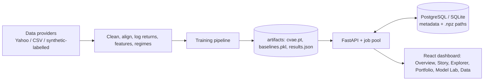

# CRASHLAB — Generative Financial Stress Testing & Portfolio Risk Intelligence

Describe a hypothetical crash in plain English, generate thousands of multivariate market paths with four competing models, push a portfolio through them, and see which model actually holds up out-of-sample. **Research/education tool — not a price predictor, not investment advice, no trade execution.**

> **Status:** models are trained and evaluated on **real NSE/Yahoo Finance daily history (2008-01 → 2026-11, 4,469 returns; chronological 60/20/20 split; test from 2023-02-06)**. 13 tests pass. **Honest headline: the conditional VAE does *not* beat the baselines on most metrics** — Filtered Historical Simulation is best on marginal fit and is the only model whose 95% VaR backtest is calibrated; the cVAE has the lowest correlation error (by a small margin). Full tables: `docs/RESEARCH_REPORT.md`. **Deployment is prepared but not live**; see [`docs/DEPLOYMENT.md`](docs/DEPLOYMENT.md) for the Render + GitHub + Vercel steps.

## Problem & why plain historical simulation is limited
Historical simulation can only replay combinations of shocks that have already happened. Stress testing needs *plausible combinations that haven't* (e.g. NIFTY −15% with rupee −4% and crude +12%). CRASHLAB compares conventional generators to a **conditional generative model** on exactly that task.

## Models (all in `backend/crashlab/models`)
| Model | Idea |
|---|---|
| Gaussian / Gaussian copula | baselines; zero tail dependence |
| Student-t copula | t marginals + t dependence ⇒ joint tail dependence λ>0 |
| Filtered Historical Simulation | per-asset GJR-GARCH-t, synchronised residual-row bootstrap, simulated variance recursion |
| **Conditional GRU-VAE (PyTorch)** | encoder/decoder GRUs, latent reparameterisation, conditions = target cumulative returns (+masks), horizon, vol regime; KL annealing, grad clipping, early stopping, checkpoints, learned full-covariance residual; constraints are **measured, never forced** |

## Architecture


## Run locally
```bash
cd backend && pip install -r requirements.txt
python -m crashlab.pipeline --no-synthetic   # train on real data (~8 min CPU; add --skip-ablations to skip the 6 extra VAE trainings); --quick = smoke run
pytest -q                              # 13 tests incl. end-to-end workflow
CRASHLAB_STATIC_DIR=../frontend/dist uvicorn crashlab.api:app --port 8000   # after: cd ../frontend && npm ci && npm run build
python ../scripts/benchmark.py && python ../scripts/make_report.py          # measured benchmarks + docs/RESEARCH_REPORT.md
```
Dev UI: `cd frontend && npm run dev` (proxies `/api`). API docs: `/docs`. Docker: `docker compose up --build`.

## API
`GET /api/health · /api/data/status · /api/data/overview · /api/models · /api/models/comparison · /api/research/metrics · /api/backtesting/{model}` · `POST /api/scenarios/parse · /api/scenarios/generate` (async job) · `GET /api/scenarios[/{id}[/export?format=csv|json]]` · `POST /api/portfolios` · `GET /api/portfolios/{id}` · `POST /api/portfolios/{id}/stress-test` · `GET /api/risk/{simulation_id}`.
Storage: simulated paths → compressed float32 `.npz` files; Postgres/SQLite rows hold metadata, summaries and risk metrics.

## Results
Auto-generated from artifacts, nothing hand-typed: **[docs/RESEARCH_REPORT.md](docs/RESEARCH_REPORT.md)** (distribution fidelity, constraint satisfaction, Kupiec/Christoffersen/Acerbi–Székely backtests, ablations, measured latency). Screenshots: `docs/screenshots/`. Method: `docs/RESEARCH_METHODOLOGY.md`; model card: `docs/MODEL_CARD.md`.

## Known limitations
FHS is conditioned on current volatility while the other models are not (unequal comparison); one dataset/seed; ablations not run in the shipped artifacts; overlapping test windows; small backtest samples; horizon ≤20 days; baselines conditioned by analog selection; gold/crude are futures proxies; generated probabilities are conditional model outputs.

## Disclaimer
Model-based simulations are not predictions or real-world probabilities. Nothing here is investment advice.
